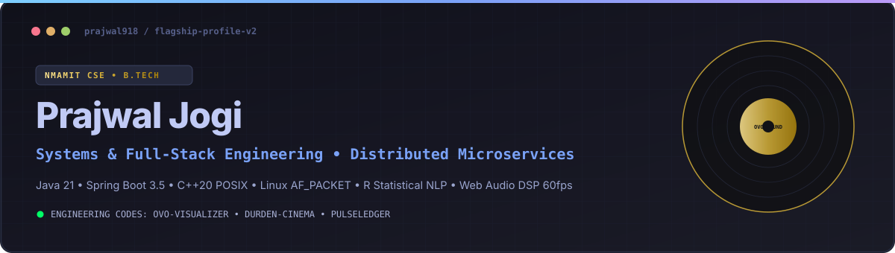
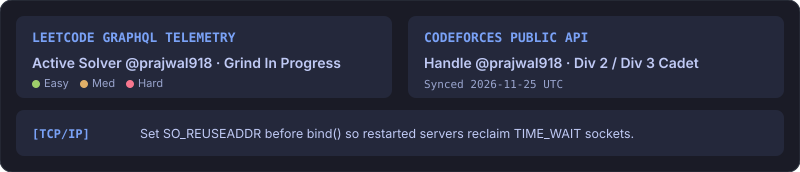
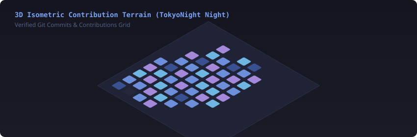

  <picture>
    <source media="(prefers-color-scheme: dark)" srcset="./assets/banner-dark.svg" />
    <source media="(prefers-color-scheme: light)" srcset="./assets/banner-light.svg" />
    
  </picture>

<h1 align="center">
  
</h1>

  
  
  
  
  

 

### Systems-minded B.Tech CSE engineer at NMAMIT building fault-tolerant backend microservices, low-level Linux networking utilities, and interactive audio/cinema web software.

* 🔭 **Currently engineering:** [`ovo-visualizer`](https://github.com/prajwal918/ovo-visualizer) (real-time Web Audio FFT + Spotify PKCE) & [`pulseledger-microservices`](https://github.com/prajwal918/pulseledger-microservices) (idempotent Java 21 / Spring Boot ledger).
* 🌱 **Deepening mastery in:** POSIX kernel networking (`AF_PACKET`, `eBPF`), distributed consensus, and statistical NLP in R.
* 💬 **Ask me about:** Spring Data JPA / Hibernate tuning, Web Audio DSP, Linux `termios` TUIs, and TCP/IP internals.
* ⚡ **Outside the terminal:** Dissecting 808 low-end mixes from OVO Sound and re-watching David Fincher & Quentin Tarantino filmography.

---

## 🏛️ Flagship Engineering Showcase

| Repository | Engineering Focus & Problem Solved | Core Stack | Architecture |
| :--- | :--- | :--- | :--- |
| **[`ovo-visualizer`](https://github.com/prajwal918/ovo-visualizer)** | Zero-dependency 60 fps Web Audio FFT visualizer (60–150 Hz 808 sub-bass detection), Spotify PKCE OAuth, and LRCLIB synced lyrics | Vanilla ES6+, Web Audio API, Canvas 2D | Client DSP + Edge Auth |
| **[`durden-cinema`](https://github.com/prajwal918/durden-cinema)** | A24/Criterion Brad Pitt filmography explorer with pure-CSS chromatic glitch shaders and OWASP-hardened TMDB serverless proxy | HTML5, Tailwind CSS v4, Serverless Proxy, TMDB v3 | Zero-Leak Edge Proxy |
| **[`pulseledger-microservices`](https://github.com/prajwal918/pulseledger-microservices)** | Idempotent double-entry settlement engine with optimistic locking (`@Version`), Redis rate limits, and transactional outbox | Java 21, Spring Boot 3.5, Hibernate, MySQL 8.4, Docker | Event-Driven Microservice |
| **[`packetscope-ux`](https://github.com/prajwal918/packetscope-ux)** | Linux `AF_PACKET` raw-socket TCP/IP sniffer detecting SYN floods and retransmission spikes inside a 60 Hz ANSI TUI | C++20, POSIX Sockets, `termios`, Linux Networking | Systems / Kernel-Adjacent |
| **[`drake-lyric-nlp`](https://github.com/prajwal918/drake-lyric-nlp)** | Reproducible R hypothesis test quantifying emotional & lexical shifts across Drake's 2009–2026 discography via Bing/AFINN/NRC | R, Tidyverse, tidytext, ggplot2, svglite, LRCLIB | Statistical NLP Pipeline |
| **[`project-mayhem-cli`](https://github.com/prajwal918/project-mayhem-cli)** | 90s green-phosphor CRT terminal simulator streaming real Linux `/proc` kernel telemetry as soap-factory diagnostics | C++20, POSIX `termios`/`ioctl`, Bash, ANSI Truecolor | Systems / POSIX TUI |
| **[`algometrix-r`](https://github.com/prajwal918/algometrix-r)** | Interactive R Shiny + Tidyverse empirical complexity explorer comparing $O(n \log n)$ vs $O(n^2)$ cache-cliff inflection points | R 4.4, Shiny, Tidyverse, ggplot2, svglite | Empirical Algorithmics |

---

## 🛠️ Core Technical Stack

  <picture>
    <source media="(prefers-color-scheme: dark)" srcset="https://skillicons.dev/icons?i=java,spring,cpp,c,python,r,js,html,css,tailwind,mysql,redis,docker,linux,bash,git,github,postman&theme=dark&perline=9" />
    <source media="(prefers-color-scheme: light)" srcset="https://skillicons.dev/icons?i=java,spring,cpp,c,python,r,js,html,css,tailwind,mysql,redis,docker,linux,bash,git,github,postman&theme=light&perline=9" />
    
  </picture>

 

  
  
  
  
  
  
  
  
  
  

---

## ⚡ Live Engineering Telemetry (100% Action-Generated)

### 🧩 Daily LeetCode, Codeforces & CS Systems Digest

  <picture>
    <source media="(prefers-color-scheme: dark)" srcset="./assets/generated/dsa-digest-dark.svg" />
    <source media="(prefers-color-scheme: light)" srcset="./assets/generated/dsa-digest-light.svg" />
    
  </picture>

 

### 📈 Verified GitHub Statistics & Language Breakdown

  <picture>
    <source media="(prefers-color-scheme: dark)" srcset="./assets/generated/stats-dark.svg" />
    <source media="(prefers-color-scheme: light)" srcset="./assets/generated/stats-light.svg" />
    
  </picture>
  <picture>
    <source media="(prefers-color-scheme: dark)" srcset="./assets/generated/langs-dark.svg" />
    <source media="(prefers-color-scheme: light)" srcset="./assets/generated/langs-light.svg" />
    
  </picture>

 

### 🏔️ 3D Isometric Contribution Terrain

  <picture>
    <source media="(prefers-color-scheme: dark)" srcset="./profile-3d-contrib/profile-night-view.svg" />
    <source media="(prefers-color-scheme: light)" srcset="./profile-3d-contrib/profile-green.svg" />
    
  </picture>

 

### 🐍 TokyoNight Platane Contribution Snake

  <picture>
    <source media="(prefers-color-scheme: dark)" srcset="https://raw.githubusercontent.com/prajwal918/prajwal918/output/github-snake-dark.svg" />
    <source media="(prefers-color-scheme: light)" srcset="https://raw.githubusercontent.com/prajwal918/prajwal918/output/github-snake-light.svg" />
    
  </picture>

 

  
<b>⏱️ Weekly IDE Telemetry (WakaTime Verified Code-Time)</b>

   
  <!--START_SECTION:waka-->
  <!--END_SECTION:waka-->

---

  Engineered with precision for NMAMIT CSE placements &amp; distributed systems roles. Zero vanity metrics, 100% verifiable code.

